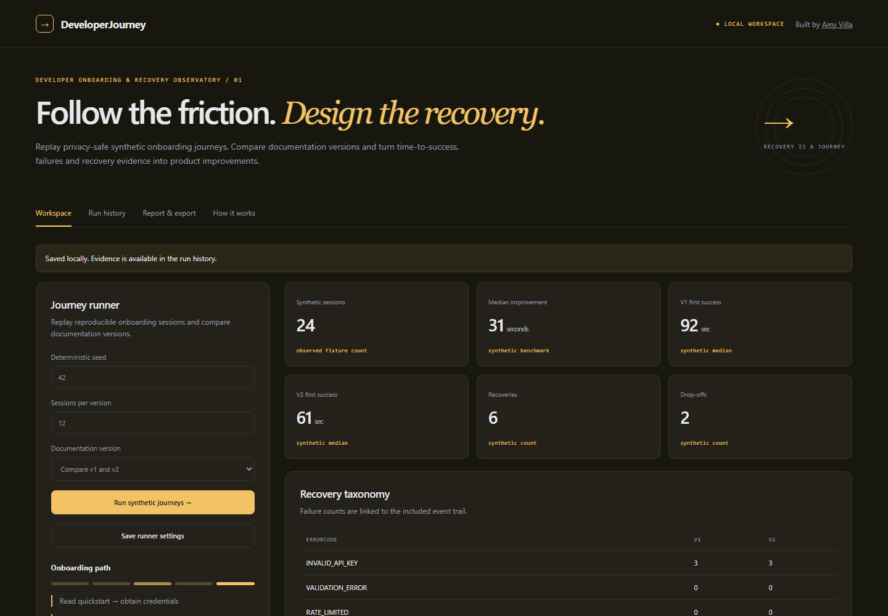

# DeveloperJourney

**Developer Onboarding & Recovery Observatory**

A synthetic-only onboarding analytics system with reproducible journeys, strict privacy validation, first-success and recovery metrics, drop-off taxonomy, documentation-version comparisons and evidence-linked recommendations.



## Run locally

Requires **Node.js 24** (uses built-in SQLite). No provider accounts or API keys.

```bash
npm ci
npm run build
npm start
```

Open **http://127.0.0.1:4315**. The server creates `data/workspace.sqlite`; state, runs and ledger events survive restart. Never commit the data directory.

For development, keep `npm start` running and run `npm run dev` in another terminal. Vite proxies `/api` to the local service.

## Inspectable capabilities

- Choose a seed and session count to produce reproducible synthetic events.
- Follow quickstart, credentials, first request, error understanding, retry and first useful task.
- Validate an event allowlist; reject extra fields, secret-like identifiers and non-synthetic events.
- Compare v1/v2 median and p95 first-success time, recovery and drop-offs.
- Link improvement recommendations to session evidence and export a clearly labelled local benchmark.

Every run supports JSON, CSV and Markdown export. Reports preserve assumptions, uncertainty, findings and records. CSV protects against spreadsheet formula injection. An optimistic revision check prevents a stale browser tab from overwriting newer state.

## Verification

```bash
npm run check
npm test
npm run build
npx playwright install chromium
npm run test:e2e
```

Domain tests challenge calculation and policy invariants. HTTP tests exercise real requests, validation, cross-origin rejection, revision conflicts and restart persistence. Browser checks exercise actual forms at desktop and mobile widths, inspect history, download exports and reject runtime errors or horizontal overflow. GitHub Actions runs these gates with read-only permissions.

## Read the engineering story

- [Architecture and data model](docs/architecture.md)
- [API contract](docs/api-contract.json) and [request guide](docs/api-guide.md)
- [Five-minute walkthrough](docs/walkthrough.md)
- [Engineering article: Measure recovery without collecting credentials](docs/engineering-note.md)
- [Scope and limitations](docs/limitations.md)
- [Verification evidence](docs/verification.md)

## Evidence boundary

Synthetic sessions only. Timing is fixture-defined, not real developer behavior. No tokens, real-user tracking or external API requests.

This is a persistent local product and tested reference implementation. It is not an authenticated multi-user SaaS or a hardened production deployment. The HTTP server defaults to loopback, rejects cross-origin requests and serves no external execution integrations. Role labels in simulations are not identity verification. See the limitations before extending it.

## Configuration

`PORT` overrides the local port. `DATABASE_PATH` overrides the SQLite path. `BIND_HOST=0.0.0.0` is intended only for an isolated container mapped to a loopback host port; default binding is `127.0.0.1`.

```bash
docker build -t developerjourney-observatory .
docker run --rm -p 127.0.0.1:4315:4315 -v developerjourney-observatory-data:/app/data developerjourney-observatory
```

The Docker recipe is provided for reproducibility; consult verification evidence to see whether it was executed.

**Maintainer:** [Amy Villa](https://github.com/Amyvdev1) · **License:** MIT
